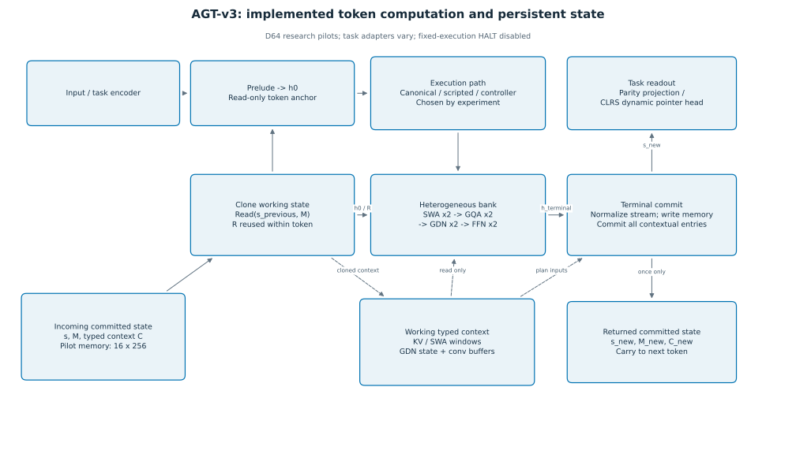
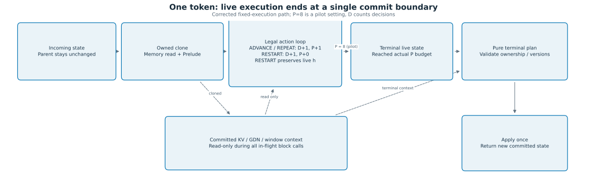
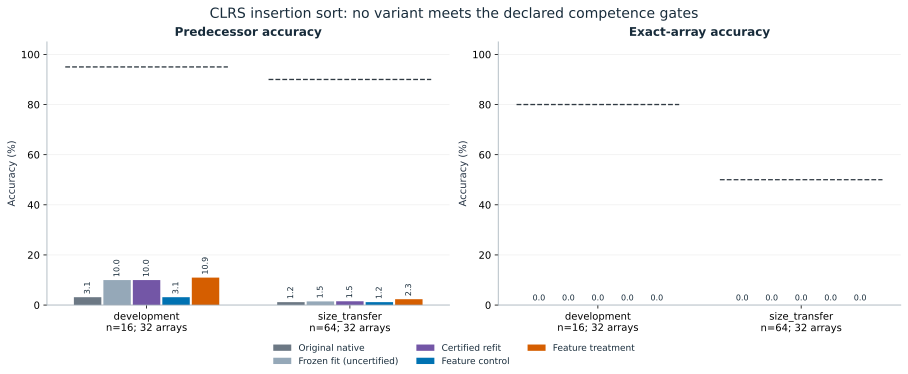
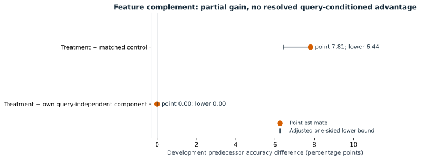

# AGT-v3

**Heterogeneous execution, persistent state, and the search for useful computation policies.**

AGT-v3 is a research implementation of token-local computation over a bank of attention, recurrent and feed-forward operators, with explicit cross-token memory, typed contextual caches and a single terminal commit. The research asks whether a learned policy can choose useful computation while preserving task-relevant state and controlling measured cost. The retained experiments establish bounded execution mechanics and positive controls on parity; they also document unsuccessful routing-discovery, compatibility-acquisition and insertion-sort learning studies. Those outcomes are part of the repository's scientific record.

**Navigate:** [Status](#current-research-status) · [Architecture](#architecture-and-state) · [Execution](#execution-semantics) · [Results](#selected-results) · [Repository map](#repository-map) · [Reproduction](#reading-and-reproduction) · [Limitations](#limitations) · [Contributing](CONTRIBUTING.md)

> **Evidence status — audited 2026-10-25.** The latest completed milestone is the paired feature-complement pilot: **`PARTIAL_EFFECT_TASK_NON_SUCCESS`**. It changed representation geometry and improved a weak accuracy baseline, but did not acquire query-conditioned sorting competence. No executed successor or newly authorized follow-up was found. Learned adaptive routing, useful program selection, general algorithmic competence and superior efficiency remain unestablished.

## Current research status

|Evidence supports|Evidence does not establish|
|---|---|
|Selected execution accounting, state isolation and once-only commits under recorded fixtures|A universal state-compatibility contract or correctness for arbitrary routes|
|A working fixed-route D64 parity backbone and canonical-route imitation/replay|Useful task-loss discovery of diverse or adaptive computation|
|Bounded maintenance of an already imitated policy|Acquisition from a fresh policy or beneficial route diversity|
|Real committed-state handoffs and writer-directed gradients in receiver fixtures|An added benefit from receiver-anchored compatibility training on the parity panels|
|Completed CLRS adapter, gradient checks and reproducible negative results|Insertion-sort competence, official CLRS-model reproduction or performance across CLRS-30|

**Branch selection matters.** The remote default, `archive/agt-v3-existing-history-20261013T183904Z`, contains the older source-history commit. Later artifacts live on research/archive branches. This guide uses the [latest completed evidence snapshot, `ea183970feea`](https://github.com/miheer-smk/Adaptive-Generative-Transformer/commit/ea183970feea1f49677f186e26065ce4e333f709), and links historical evidence by immutable commit. A report's publication revision may differ from its execution HEAD and fingerprinted working-tree diff. See the [32-milestone index](docs/experiment_index.md), [machine-readable inventory](docs/evidence_inventory.json) and [audited branch state](docs/maintenance/repository_state_20261025.json).

## Architecture and state



*Scope: the implemented sequential/fixed-execution substrate and D64 research pilots. Input encoders and task heads vary by experiment. The diagram does not assert full blueprint equivalence. [Editable diagram source](docs/figure_sources/architecture.mmd) · [source map and details](docs/architecture.md).*

The locked bank order is:

|Index|0|1|2|3|4|5|6|7|
|---|---|---|---|---|---|---|---|---|
|Operator|SWA|SWA|GQA|GQA|GDN|GDN|FFN|FFN|

SWA is windowed attention; GQA is grouped-query attention; the bank's GDN uses `gdn_v3.py`; FFN-heavy blocks contain SwiGLU and an internal feature mixer. Operator names describe implementations, not demonstrated task specialization.

For each token, the incoming committed state contains the stream vector, persistent memory and typed contextual state. A memory read and Prelude construct the initial live stream and a read-only token anchor. Selected operators update the live stream using committed context; they do not commit intermediate cache updates. At completion, the terminal plan normalizes the live stream, writes memory, and updates all contextual entries, including entries whose bank blocks were not selected. The returned committed state supplies the next token and task readout.

The source exposes different execution paths:

- `AGTv3.step`: a deterministic complete bank sweep, used by the canonical parity and CLRS controls.
- Fixed-execution Stage- 3 routing: controller actions or scoped scripted providers select legal block operations. Deterministic inference executes selected blocks; ST training constructs exhaustive successor candidates for relaxed backward credit.
- Separate adaptive-depth/legacy paths: their presence is not evidence of validated halting or adaptive-compute learning.

The D64 controller is **395 → 256 → 11**: live state64, memory read64, raw slot mean256, pointer9 and budget2. Actions are eight ADVANCE targets plus REPEAT, RESTART and HALT. In the documented fixed-depth pilots HALT/convergence are disabled; CLRS uses scripted/canonical execution and freezes the registered controller. Many parity pilots freeze the backbone and train only the controller; the CLRS learning runs instead train the task adapter and non-controller core.

**Pilot settings are not universal architecture constants.** D64, 16 memory slots and eight selected executions describe these pilots. `AGTv3` constructor defaults, `src/config.py` blueprint-oriented constants and archived experiments differ. The standalone blueprint is referenced as pre-freeze v0.1 but was not located. Older deviation notes also contain superseded statements. [Implementation versus blueprint](docs/implementation_vs_blueprint.md) records these distinctions without rewriting historical files.

## Execution semantics

|Action|Decision count D|Actual selected execution count P|Within-token effect|
|---|---:|---:|---|
|ADVANCE(j)|+1|+1|Execute legal target j and move the pointer|
|REPEAT|+1|+1|Re-execute the current block from the evolving live stream and unchanged committed context|
|RESTART|+1|+0|Reset routing metadata; preserve the live stream|
|HALT|Separate path|No selected block by itself|Excluded from fixed-execution Stage- 3 selection|

Fixed-depth completion uses **actual executions**, not decision count. At P=8, RESTART can make D larger than8; the retained alternating ADVANCE/RESTART control has P=8 and D=15. Earlier eight-decision experiments retain their original meaning. One terminal commit occurs per completed token. **Eight selected block calls are not eight total operator computations:** exhaustive ST candidates and contextual commit work add computation. No FLOP or efficiency advantage follows from P alone.



*Scope: corrected fixed-execution path. Persistent state changes at the terminal boundary; a live hidden state is not the complete committed state. [Editable source](docs/figure_sources/token_execution.mmd) · [semantics and source locations](docs/architecture.md#execution-and-commit-contract).*

## Selected results

|Milestone|Observed result|Justified interpretation|
|---|---|---|
|Gate-A frozen parity state studies|GDN-state ablation/shuffling affected parity; state patching did not establish transfer|State involvement under those interventions; no unique-state or donor-parity-transfer claim|
|Canonical imitation and replay|Fresh controller seeds 4401/4402 recovered the teacher route and reference behavior|Supervised canonical recovery, not route discovery|
|Fresh task-loss routing / independent-noise averaging|Declared reference-level discovery/useful-policy repair not established|The bounded formulations did not discover a useful policy|
|Two-program feasibility v1–v4|v1 stopped before P1; v2/v3 inspection stops; v4 rejected a current boundary|Stopped attempts remain evidence; v4 ran no futures/joint bootstrap|
|Receiver-anchored parity study|Both arms saturated robust panels; Δ=0, retained 95% interval[0,0]; four operation-ablation drops0|`COMPLETED_NON_SUCCESS`; no added compatibility benefit or task-relevant heterogeneity established|
|Keyed-register qualification|78/128 updates, then resource closure; no final development|`engineering/integrity/resource stop`; benchmark unqualified|
|Original CLRS insertion sort|Development3.125%, size 64 transfer1.171875% predecessor accuracy; exact arrays0%|`COMPLETED_NON_SUCCESS`|
|Frozen bilinear readout / separate refit|Original fit missed its certificate; separately certified refit remained incompetent|`INCONCLUSIVE_NONCONVERGED_OPTIMIZATION` and `CERTIFIED_FIXED_OBJECTIVE_NON_SUCCESS` remain distinct|
|Feature-complement pilot|Development treatment10.9375% versus control3.125%; treatment equals its own query-independent predictions|`PARTIAL_EFFECT_TASK_NON_SUCCESS`; all competence gates failed|



*Each development/transfer panel has32 complete arrays, with 512/2048 pointers. All exact-array scores are 0. Dashed segments show locked competence thresholds. Frozen fits use the failed core's states; feature arms train fresh cores. These are different studies, not independent replicates. [Provenance](docs/figure_sources/figure_provenance.json) · [numerical results and limits](docs/research_results.md).*



*Point estimates and retained Bonferroni-adjusted one-sided lower bounds, not two-sided intervals: treatment minus control **+7.8125 pp**, lower **+6.44043 pp**; treatment minus own query-independent component **0**, lower **0**. One paired initialization and historically examined panels. More geometric variation did not restore competence. [Authoritative pilot report](https://github.com/miheer-smk/Adaptive-Generative-Transformer/blob/ea183970feea1f49677f186e26065ce4e333f709/experiments/results/gatec_clrs_feature_complement_pilot_6400_v1/report_v1.md).*

The [results guide](docs/research_results.md) explains why these studies did not meet their hypotheses. The [research overview](docs/research_overview.md) traces how each informed the next question without treating an unsuccessful predecessor as validation.

## Repository map

|Location|Role|
|---|---|
|[`src/`](src/README.md)|Shared implementation: blocks, routing, persistent memory/caches, commit and readout. `.bak` copies are archival implementations.|
|[`data/`](data/task_a.py)|Parity generator/encoding; CLRS exports and adapters are experiment-specific.|
|[`experiments/`](experiments/README.md)|Research runners and diagnostics; immutable run evidence under `experiments/results/`, historical controls under `experiments/runs/`.|
|[`tests/`](tests/README.md)|Mechanics/gradient/state tests, some model-executing; historical failures are documented.|
|[`docs/`](docs/README.md)|Current guide, evidence index, source reconciliation, reproducibility and limitations; original uppercase notes are preserved.|
|[`docs/figures/`](docs/figures/README.md)|Generated SVG/PNG assets with captions and provenance.|
|[`scripts/documentation/`](scripts/documentation/README.md)|Offline figure/index/documentation checks; no model execution.|

## Reading and reproduction

1. **Read:** start with the [evidence index](docs/experiment_index.md). Reports are accessible through commit-pinned links; the old default branch does not contain the full record.
2. **Regenerate presentation figures:** obtain the nine JSON/CSV inputs listed in [source hashes](docs/figure_sources/result_source_hashes.json), plus this documentation branch. No checkpoint, AGT import, GPU, model inference or probe fitting is needed.
3. **Validate documentation:** use the standard-library checker below. It checks new links/assets, numerical data and preservation records; it does not run model tests.
4. **Reproduce experiments:** inspect the execution-specific protocol, implementation seal, environment, dataset and output guards first. Historical runners are not portable one-command demos. [Reproducibility](docs/reproducibility.md) distinguishes recorded execution from verification performed for this guide.

```bash
# Documentation-only checks; run from the repository root.
python3 -B scripts/documentation/validate_docs.py

# Isolated presentation tools, outside the research environment.
python3 -m venv /tmp/agt-docs-env
/tmp/agt-docs-env/bin/python -m pip install -r docs/figure_sources/requirements.txt
/tmp/agt-docs-env/bin/python scripts/documentation/render_figures.py
/tmp/agt-docs-env/bin/python scripts/documentation/render_figures.py --check-data
```

The plotting workflow was executed for this guide using Matplotlib3.10.7 in a separate environment. Exact resolved tool versions are recorded with figure sources. Research CLRS runs recorded Python3.12, PyTorch2.10.0+cu130, CUDA13.0 and NVIDIA GB10, FP32/TF32 disabled. There is **no project-wide dependency lock or current green CI claim**. The vendored official CLRS export has its own pinned source and historical CPU requirements; those packages are unnecessary for reading reports or regenerating these figures.

## Limitations

Evidence is limited to toy parity, an incomplete keyed-register qualification and a serialized output-only adaptation of one CLRS task. Several studies use one initialization, small panels, repeated stochastic tapes, previously examined evaluation inputs, or one-array diagnostics. Frozen-state decodability differs from end-to-end learning. Finite continuation checks do not establish universal state equivalence; connected/finite gradients do not prove useful credit assignment. Selected-block counts do not include all candidate/commit work and do not establish deployment efficiency.

Known historical failures, stopped attempts, bytecode-integrity exceptions, unavailable blueprint material and stale descriptions remain visible. See [limitations and evidence conflicts](docs/limitations.md) and [development/test boundaries](docs/development.md). No new scientific experiment was run to prepare this documentation.

## Licensing, citation and contributions

No project-wide license or preferred publication/citation metadata was found in the audited repository. This guide does not assign a license, authorship, institution, DOI or paper status. The vendored [official CLRS source license](https://github.com/miheer-smk/Adaptive-Generative-Transformer/blob/ea183970feea1f49677f186e26065ce4e333f709/experiments/results/gatec_clrs_insertion_sort_6200_v1/official_source/LICENSE) is preserved and applies to that upstream material; it is not presented as a license for all AGT code. Cite the exact repository commit and reports used until maintainers supply preferred metadata. No speculative `CITATION.cff` is added.

Contributions should preserve evidence first: record source/data identities, declare hypotheses and budgets prospectively, keep historical classifications, and separate new variants from production semantics. Read [CONTRIBUTING.md](CONTRIBUTING.md) and the [artifact policy](docs/artifact_policy.md). New experiments require their own explicit research authorization.
