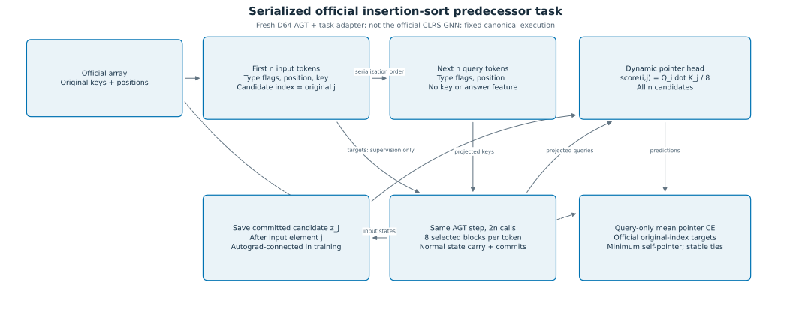

# Implementation-grounded architecture

**Scope:** source content at [ea183970feea](https://github.com/miheer-smk/Adaptive-Generative-Transformer/commit/ea183970feea1f49677f186e26065ce4e333f709), with D64 research settings where stated. Source reading and archived tests support different levels of evidence; no model is run for this guide. The standalone pre-freeze blueprint was not located. See [reconciliation](implementation_vs_blueprint.md).

## Components and ownership

*Input encoding and readout are task-specific. The bank and persistent-state transition are the shared substrate. [Editable Mermaid](figure_sources/architecture.mmd) and [diagram definitions](figure_sources/diagrams.json).*

|Component|Implemented role|Source at the audited revision|
|---|---|---|
|AGTv3 composition|Memory, Prelude, dedicated Prelude context owner, eight-block bank, controller, executor, commit and output head|[agt.py L39–105](https://github.com/miheer-smk/Adaptive-Generative-Transformer/blob/ea183970feea1f49677f186e26065ce4e333f709/src/agt.py#L39-L105)|
|Bank|`SWA,SWA,GQA,GQA,GDN,GDN,FFN,FFN`; separate block instances; repeat visits reuse that block's parameters|[blocks.py L445–517](https://github.com/miheer-smk/Adaptive-Generative-Transformer/blob/ea183970feea1f49677f186e26065ce4e333f709/src/blocks.py#L445-L517)|
|Attention|SWA windowed implementation and GQA with 8 query/2 KV heads|[blocks.py L27–110](https://github.com/miheer-smk/Adaptive-Generative-Transformer/blob/ea183970feea1f49677f186e26065ce4e333f709/src/blocks.py#L27-L110), [L203–233](https://github.com/miheer-smk/Adaptive-Generative-Transformer/blob/ea183970feea1f49677f186e26065ce4e333f709/src/blocks.py#L203-L233)|
|GDN|Bank imports `GDNv3`; ephemeral recurrence and committed recurrence/buffer are distinct|[blocks.py L5–14](https://github.com/miheer-smk/Adaptive-Generative-Transformer/blob/ea183970feea1f49677f186e26065ce4e333f709/src/blocks.py#L5-L14), [gdn_v3.py](https://github.com/miheer-smk/Adaptive-Generative-Transformer/blob/ea183970feea1f49677f186e26065ce4e333f709/src/gdn_v3.py)|
|FFN-heavy|Internal pre-norm, SwiGLU, mHC, then raw residual addition|[blocks.py L113–150](https://github.com/miheer-smk/Adaptive-Generative-Transformer/blob/ea183970feea1f49677f186e26065ce4e333f709/src/blocks.py#L113-L150)|
|mHC|Learned constrained feature-mixing matrix and coordinatewise post-mix gain; it is not a demonstrated multi-stream residual router|[mhc.py L28–83](https://github.com/miheer-smk/Adaptive-Generative-Transformer/blob/ea183970feea1f49677f186e26065ce4e333f709/src/mhc.py#L28-L83)|
|Prelude|Constructs h0 from input, previous stream, memory read and compatibility tensor|[prelude.py L42–76](https://github.com/miheer-smk/Adaptive-Generative-Transformer/blob/ea183970feea1f49677f186e26065ce4e333f709/src/prelude.py#L42-L76)|
|Memory|16 slots in pilots; memory width256; learned initial memory and read projections|[memory.py L20–48](https://github.com/miheer-smk/Adaptive-Generative-Transformer/blob/ea183970feea1f49677f186e26065ce4e333f709/src/memory.py#L20-L48)|
|Controller|D64 feature dimensions64+64+256+9+2=395, MLP395→256→11; no complete-program selector in core|[controller.py L54–77](https://github.com/miheer-smk/Adaptive-Generative-Transformer/blob/ea183970feea1f49677f186e26065ce4e333f709/src/controller.py#L54-L77), [L244–268](https://github.com/miheer-smk/Adaptive-Generative-Transformer/blob/ea183970feea1f49677f186e26065ce4e333f709/src/controller.py#L244-L268)|
|Task output|Terminal-normalized committed stream feeds a bias-free output projection; no second output normalization or embedding-weight tie is established by this code|[commit.py](https://github.com/miheer-smk/Adaptive-Generative-Transformer/blob/ea183970feea1f49677f186e26065ce4e333f709/src/commit.py#L20-L49), [output_head.py](https://github.com/miheer-smk/Adaptive-Generative-Transformer/blob/ea183970feea1f49677f186e26065ce4e333f709/src/output_head.py#L17-L43)|

Memory is read once from the incoming committed stream and reused as R within the token in the validated paths. This is not a new memory read after every routing decision. The supplied two-component budget is not automatically a remaining-compute fraction. The separate `C_prev` Prelude compatibility tensor is not the structured `state.ctx`; recorded pilots commonly supply a zero compatibility tensor and zero budget features.

## Execution and commit contract

*Scope: corrected fixed-execution Stage 3 path. An ordinary canonical `step` directly visits the bank and bypasses the learned router. [Editable source](figure_sources/token_execution.mmd).*

|Action ID|Meaning|D increment|P increment|Pointer|
|---|---|---:|---:|---|
|0–7|ADVANCE to a legal higher block, or any block initially/after RESTART|1|1|Selected block|
|8|REPEAT current block|1|1|Unchanged|
|9|RESTART routing sweep|1|0|Reset0; live h preserved|
|10|HALT|Separate path|No selected execution by itself|Excluded in fixed-execution Stage 3|

The initial/post-RESTART mask permits all ADVANCE targets and forbids REPEAT/consecutive RESTART. After executing i, only higher ADVANCE targets plus REPEAT/RESTART are permitted. Full masks include HALT, while fixed-depth successor selection removes it. [Mask source](https://github.com/miheer-smk/Adaptive-Generative-Transformer/blob/ea183970feea1f49677f186e26065ce4e333f709/src/masks.py#L26-L100), [dispatch/counters](https://github.com/miheer-smk/Adaptive-Generative-Transformer/blob/ea183970feea1f49677f186e26065ce4e333f709/src/executor.py#L620-L747).

P counts actual selected bank executions. With the pilot budget P=8, D can be8–15 because initial/consecutive RESTART are forbidden. Canonical sweeps and the scripted P1 examples without RESTART have D=P=8. This does not retroactively alter historical eight-decision studies.

ST routing has a hard forward selection and relaxed backward. Its exhaustive builder evaluates eight ADVANCE candidates plus REPEAT, including masked candidates; RESTART is identity. That construction cost differs from selected-only deterministic inference. Calling `differentiable_route_step(training=False)` still constructs candidates; selected-only behavior is in the outer `execute_differentiable(training=False)` dispatch. [Routing](https://github.com/miheer-smk/Adaptive-Generative-Transformer/blob/ea183970feea1f49677f186e26065ce4e333f709/src/routing.py), [executor](https://github.com/miheer-smk/Adaptive-Generative-Transformer/blob/ea183970feea1f49677f186e26065ce4e333f709/src/executor.py#L654-L718). Hard argmax for the recorded Gumbel convention uses softmax(logits), not softmax(logits/tau); tau affects the relaxation.

`AGTPersistentState` contains stream s, memory M, typed context, token count and consumed metadata. Context includes attention KV/window positions and GDN recurrent state/conv buffers with versions. Its clone recursively clones tensors and metadata; ordinary `Tensor.clone` preserves autograd. Serialization/capture code may intentionally detach copies, but those copies must not replace the live training state. [State/clone source](https://github.com/miheer-smk/Adaptive-Generative-Transformer/blob/ea183970feea1f49677f186e26065ce4e333f709/src/terminal_commit.py#L87-L131), [caches](https://github.com/miheer-smk/Adaptive-Generative-Transformer/blob/ea183970feea1f49677f186e26065ce4e333f709/src/caches.py).

In-flight operators consume committed context without persisting their ephemeral results. Pure terminal planning constructs payloads for all six context-bearing bank entries and the dedicated Prelude context. Payloads are recomputed at their prescribed terminal boundary, including skipped entries. Final normalization produces s; memory writing uses that state. Applying the plan validates object ownership, token count and versions, commits once and returns the next state. Raw addresses are within-run ownership assertions, not historical equality targets. [Commit plan/application](https://github.com/miheer-smk/Adaptive-Generative-Transformer/blob/ea183970feea1f49677f186e26065ce4e333f709/src/terminal_commit.py#L168-L240).

## CLRS task-specific adaptation

*Actual order: n original-element tokens, then n query tokens; this diagram is not a conceptual insertion-sort algorithm or CLRS GNN. [Editable source](figure_sources/clrs_pipeline.mmd).*

The fresh seed 6200 adapter encodes four features: input/query type flags, original position, and key value on input tokens only. It saves each candidate's committed s after processing its original element. Query i asks for the predecessor of original element i; the dynamic head scores all n saved candidates with query/key projections divided by8. Mean pointer CE supervises all query positions. Targets index original elements, including the minimum's self-pointer and stable ties. Permutation enforcement is disabled. State carry and terminal commits remain ordinary AGT transitions. [Adapter L48–108](https://github.com/miheer-smk/Adaptive-Generative-Transformer/blob/ea183970feea1f49677f186e26065ce4e333f709/experiments/results/gatec_clrs_insertion_sort_6200_v1/clrs_adapter_v1.py#L48-L108).

Size16 therefore uses 32 model-token calls; size 64 uses 128. The current GQA position limit is256, a source limit rather than evidence of arbitrary-length generalization. [Position guard](https://github.com/miheer-smk/Adaptive-Generative-Transformer/blob/ea183970feea1f49677f186e26065ce4e333f709/src/gqa.py#L278-L284).

The latest feature-complement research module binds only eight active bank mixers: six outer attention/GDN sites and two internal FFN sites. It computes `(X @ (P+Q).T)*g`, `Q=I64-ones/64`, with no new trainable parameter and no Prelude-mixer change. This is an isolated research variant; `src/mhc.py` remains the original operator. [Variant source](https://github.com/miheer-smk/Adaptive-Generative-Transformer/blob/ea183970feea1f49677f186e26065ce4e333f709/experiments/results/gatec_clrs_feature_complement_pilot_6400_v1/pilot_modules_v1.py).
