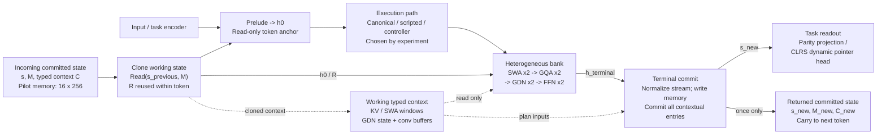
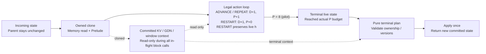
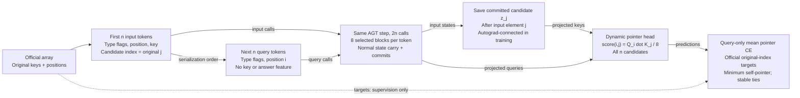

# Editable Mermaid diagrams

The SVG/PNG fallbacks and these Mermaid sources share one editable graph definition. Static images use the coordinates in diagrams.json; Mermaid chooses its own layout. Arrows do not assert scientific validation.

## AGT-v3: implemented token computation and persistent state

D64 research pilots; task adapters vary; fixed-execution HALT disabled

## One token: live execution ends at a single commit boundary

Corrected fixed-execution path; P=8 is a pilot setting, D counts decisions

## Research lineage: questions and evidence, not a chain of successes

Dashed arrows mean next question / reused substrate; exact statuses remain in the index

```mermaid
flowchart LR
    mechanics["Mechanics + parity reference<br/>Scoped positive controls"]
    imitation["Canonical imitation / replay<br/>Supervised recovery"]
    discovery["Task-loss routing discovery<br/>Not established"]
    programs["Complete-program feasibility<br/>v1-v3 stopped; v4 rejected"]
    receiver["Receiver-anchored parity<br/>COMPLETED_NON_SUCCESS"]
    keyed["Keyed-register qualification<br/>Resource stop; unqualified"]
    clrs["CLRS fixed-program learning<br/>COMPLETED_NON_SUCCESS"]
    audit["Localization / residual / mHC<br/>Bounded diagnostics"]
    probe["Frozen bilinear readouts<br/>Uncertified then certified<br/>Competence not recovered"]
    feature["Feature-complement paired pilot<br/>PARTIAL_EFFECT_TASK_NON_SUCCESS"]
    next["No executed successor found<br/>New research decision required"]
    mechanics -.-> imitation
    imitation -.-> discovery
    discovery -.-> programs
    programs -.-> receiver
    receiver -.-> keyed
    keyed -.-> clrs
    clrs -.-> audit
    audit -.-> probe
    probe -.-> feature
    feature -.-> next
```

## Serialized official insertion-sort predecessor task

Fresh D64 AGT + task adapter; not the official CLRS GNN; fixed canonical execution

