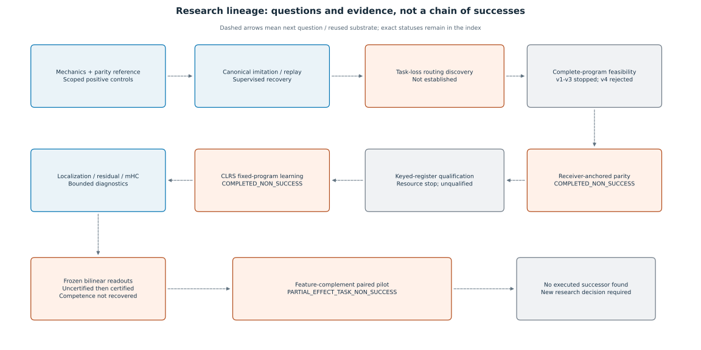

# Research questions and evidence lineage

AGT-v3 studies **which computation to execute**, **what state to retain**, and **whether that choice helps a task at an acceptable measured cost**. These are different questions. Executing a legal heterogeneous program does not establish that its operations are useful, that a policy can learn it, or that adapting the program beats a strong fixed baseline.

## Five evidence categories

|Category|What can support it|What does not suffice|
|---|---|---|
|Implementation behavior|Source plus scoped trace/equivalence/purity tests|A blueprint diagram or a passing task score alone|
|Task competence|Correct predictions on declared panels and metrics|Low loss on an unverified label convention or connected gradients|
|Policy discovery|Useful task behavior acquired without prescribed teacher routes|Canonical imitation or retention of an already competent route|
|Program/state compatibility|Real returned-state handoffs under finite declared continuations|Equal current predictions, isolated stream-vector similarity or state cloning alone|
|Adaptive-compute advantage|A learned causal policy beating strong fixed baselines with matched capacity/exposure and measured total cost|Route diversity, selected-block count or operator names|

## Coherent research history

*Edges indicate a subsequent question or reused substrate, not scientific validation by an unsuccessful predecessor. [Editable source](figure_sources/evidence_map.mmd). Exact reports and statuses are in the [index](experiment_index.md).*

1. **Build and inspect the substrate.** Gate-A examined committed GDN state in a working frozen parity model. Ablation/shuffling supported state involvement, while donor-state patching did not establish parity transfer. Canonical replay later separated selected executions from routing decisions and identified historical diagnostic/test limitations.
2. **Separate route recovery from discovery.** Supervised controllers could reproduce the canonical route, including fresh controller-seed replications. A short task-loss continuation preserved that competent route. Fresh task-loss routing and the paired independent-noise averaging intervention did not establish reference-level discovery or useful-policy repair. These are distinct outcomes, not contradictory verdicts on one experiment.
3. **Ask whether complete programs can share state.** A source audit found reusable execution/state interfaces. Attempts v1–v3 stopped at engineering/specification barriers. v4 passed P0 archival/current checks, then rejected its fixed P1 candidate at a current boundary. No future-continuation verdict is available from that stopped attempt. The later offline forensic analysis cannot fill its unexecuted cells.
4. **Acquire compatibility through real receivers.** The receiver-anchored parity study validated its engineering prerequisites and completed its locked schedule. Both arms saturated the robust panels, the treatment effect was zero and distinguishing-operation ablations caused no accuracy decrease. Its preregistered outcome remains `COMPLETED_NON_SUCCESS`.
5. **Seek a less saturated task.** Streaming keyed-register qualification stopped at 78/128 updates under the resource cap, before final development. The benchmark remained unqualified; no later nine-hour retry is inferred from a proposal.
6. **Test one standard algorithmic target.** Official insertion-sort predecessor labels were adapted to serialized AGT plus a dynamic pointer head. Engineering passed; the completed 1000-update run did not acquire competence. Localization, residual/mHC capture and offline readout studies characterized the failure without changing it. A nonconverged probe and its separately certified refit keep separate classifications.
7. **Test a fixed feature-complement intervention.** The latest paired pilot reproduced the failed control exactly and added only the locked complement at eight active mixers. It improved a weak accuracy baseline, but all competence gates failed and native predictions equaled the query-independent component. Its outcome is `PARTIAL_EFFECT_TASK_NON_SUCCESS`.

## Program names are local to their protocols

|Namespace|P1 actions|Selected blocks|
|---|---|---|
|Two-program feasibility v4|`[0,1,2,3,4,5,8,7]`|`[0,1,2,3,4,5,5,7]`|
|Receiver-anchored study|`[0,1,2,3,8,5,6,7]`|`[0,1,2,3,3,5,6,7]`|
|CLRS feature-complement pilot|Canonical program only|`[0,1,2,3,4,5,6,7]`; the mixer operator differs between arms|

Each substitution is a compound program intervention. REPEAT resolves the current pointer; an action ID is not a block index in every case. No result for one P1 silently applies to another.

## Current boundary

As of 2026-10-25, the latest verified research snapshot is [ea183970feea](https://github.com/miheer-smk/Adaptive-Generative-Transformer/commit/ea183970feea1f49677f186e26065ce4e333f709). No executed successor, selector-training result, full CLRS-suite result or newly authorized next experiment was located. Provisional Stage 4 specifications and historical recommendations remain proposals, not proof of execution. The documentation task does not authorize another experiment.

The meaningful unresolved question is still whether this substrate can acquire useful task-conditioned computation beyond a competent fixed route. The present record does not answer it positively. This is a limitation of the evidence and tested formulations, not a proof that all possible AGT variants fail.
