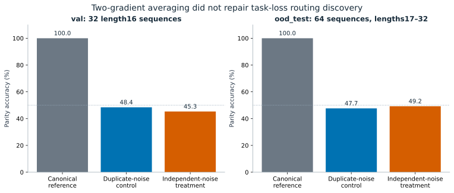
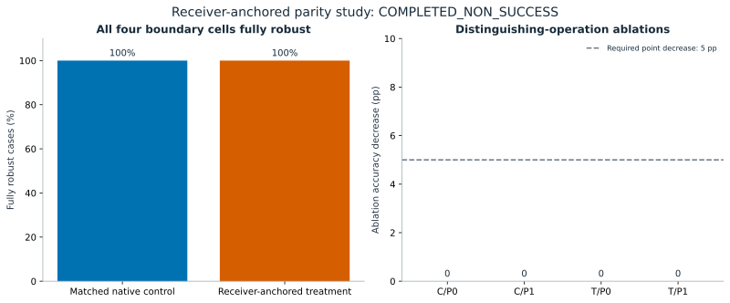
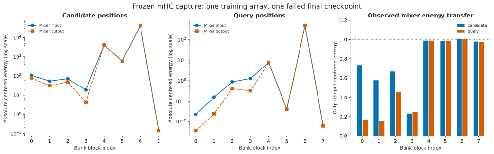
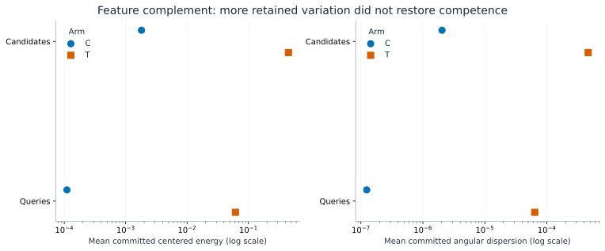

# Results and interpretation boundaries

These figures read retained JSON/CSV only. All inputs, revisions, hashes, transformations, units and regeneration commands are in [figure provenance](figure_sources/figure_provenance.json). No model, checkpoint, runner or probe was executed for this guide. [Full experiment index](experiment_index.md).

## Mechanics, imitation and discovery are separate

The accounting replay verified canonical agreement across the tested native/exhaustive/selected-only paths, and demonstrated P=8/D=15 with seven RESTART decisions. That is scoped mechanical evidence. Canonical imitation and fresh controller-seed replications recovered a prescribed route on their locked panels. Warm task loss then preserved an already competent imitated route. None establishes discovery of useful diverse computation.

*The paired seed 4900 intervention used520 updates per arm and two rollouts per update. Control averages identical-noise gradients; treatment averages independent lanes. C/T bars pool four fixed tapes over 32 validation and 64 OOD sequences. The deterministic canonical reference uses those inputs. There are no newly estimated error bars, and 128/256 tape-sequence observations are not128/256 independent inputs. The retained decision is `intervention_helped=false`, `useful_policy_repair=false`. [Report](https://github.com/miheer-smk/Adaptive-Generative-Transformer/blob/1dd215e24407b8e497abd7e4c92de5702fc25821/experiments/results/gatec_paired_gradient_average_4900_v1/paired_report.md).*

The fresh seed 4700 routing experiment also failed its reference-level discovery criterion. Its original bytecode-integrity incident and failure record remain part of the evidence; later source/checkpoint hash checks do not restore the missing original bytecode bytes. The matched-prefix offline analysis was unresolved: its six-pair primary estimate was+1.65821 pp with an approximate conditional interval containing zero. These are different diagnostic scopes, not training replications.

## State compatibility: preserve the stopping boundaries

Two-program attempts v1–v3 did not execute a valid P1 scientific evaluation. v4 passed its archival P0 gate and all 96 P0→P0 current cases, but rejected a P1-history/P0-boundary case at `acquisition/L16/row03`. That attempt executed1979 tokens and **zero future continuations/joint bootstraps**. The missing row03 P1→P1 boundary is unobserved. Its offline forensics cannot replace missing execution.

The receiver-anchored study used a different P1 definition and real committed-state continuation training. Its positive mechanical/gradient prerequisites do not make its scientific endpoint positive.

*512 complete confirmation base cases, clustered with all cells/suffixes/schedules. Both arms achieved fully robust outcomes on all four boundary cells; the primary treatment effect was 0, with retained 95% interval[0,0]. All four distinguishing-operation ablation decreases and adjusted lower bounds were 0; latency criteria passed. The result remains `COMPLETED_NON_SUCCESS`. The degenerate interval is not universal state equivalence. [Final concise report](https://github.com/miheer-smk/Adaptive-Generative-Transformer/blob/1dd215e24407b8e497abd7e4c92de5702fc25821/experiments/results/gatec_receiver_anchored_compatibility_6000_v1/concise_report_v1.md).*

The keyed-register pilot then stopped after 78/128 updates under its two-hour/resource boundary. Final development and operation ablations did not run. Its authoritative closure is `engineering/integrity/resource stop`, not a passed qualification or completed negative benchmark result.

## CLRS learning and readout studies

The official insertion-sort predecessor task is serialized as n input tokens and n query tokens. This changes model/interface/supervision relative to the official CLRS GNN setting; it is not an official-model reproduction or suite-wide result. All reported development/transfer panels below contain32 complete arrays. They were held out from the corresponding training/readout fitting, but examined historically.

|Study / native condition|Development predecessor accuracy|Size64 predecessor accuracy|Exact arrays on both|
|---|---:|---:|---:|
|Original end-to-end model|3.1250%|1.1719%|0%|
|Original frozen readout, uncertified terminal iterate|9.9609%|1.4648%|0%|
|Separately certified bilinear refit|9.9609%|1.5137%|0%|
|Feature-complement control|3.1250%|1.1719%|0%|
|Feature-complement treatment|10.9375%|2.3438%|0%|

All listed conditions fail the original 95%/80% size 16 and 90%/50% size 64 predecessor/exact-array gates. The original model's CE is near ln16/ln64; it is not a competent algorithmic learner under the tested recipe. Connected gradients, finite optimization and valid mechanics do not establish task-aligned credit.

The first frozen-state fit stops at 256 accepted L-BFGS iterations without its certificate and retains `INCONCLUSIVE_NONCONVERGED_OPTIMIZATION`. The separate exploratory refit starts at zero with fresh optimizer history, reuses fixed training-only whitening, and first passes its certificate at 341 accepted updates. Its status is `CERTIFIED_FIXED_OBJECTIVE_NON_SUCCESS`. It improves over a weak original head but not over its own query-independent component, and does not restore competence. Neither result proves universal representation or bilinear-readout impossibility. FP32 is primary; fixed FP64 sensitivity did not recover competence.

## What geometry measurements establish

*One retained training array, `official/train/row0000`, and the failed original final checkpoint. Actual active-mixer inputs/outputs are captured, not reconstructed by inversion. Absolute centered energies use a labeled log scale; output/input ratios start at zero. Attention mixers further attenuate some existing positional distinctions. The surrounding residual can preserve them, so this is not a unique causal explanation of historical failure or proof of task-relevant information loss. [Capture report](https://github.com/miheer-smk/Adaptive-Generative-Transformer/blob/d9d5eb0061b860b796f64fbc559420caff863509/experiments/results/gatec_clrs_mhc_capture_6200_v1/report_v1.md).*

The residual/score audit distinguished common-component growth, absolute centered energy, radial versus angular variation, gain-weighted effective mixers and target-conditioned interaction. The offline raw-state readout retained large radial differences but remained dominated by one globally preferred candidate on that array. Lower CE after a fixed global rescaling did not create better rankings. These diagnostics do not reproduce the historical causal sequence of training.

## Latest completed paired pilot

The exact intervention is `(X @ (P+Q).T)*g`, `Q=I64-ones/64`, at six outer bank mixers and two FFN-core mixers. There are no new trainable parameters or Prelude-mixer change. Both arms start from the exact original seed 6200 identity and receive 1000 updates on the same 1000 size 16 arrays. The control's final parameter/buffer hash exactly matches the historical failed run.

Development treatment-minus-control is+7.8125 pp, with adjusted one-sided lower bound+6.44043 pp. Treatment-minus-own-query-independent component is0 with lower bound0. The native/common predictions are identical in every evaluated trajectory; each head selects one candidate per array. All exact-array scores are 0 and invalid-chain frequency is100%. Full metric/control/CE tables remain in the [authoritative report](https://github.com/miheer-smk/Adaptive-Generative-Transformer/blob/ea183970feea1f49677f186e26065ce4e333f709/experiments/results/gatec_clrs_feature_complement_pilot_6400_v1/report_v1.md).

*Means over 32 development arrays, candidate/query roles separated. Treatment has more committed positional/angular variation, but the two final arms also have different learned parameters and trajectories. These are descriptive log-scale dot plots, not error bars or a same-weight isolated-module intervention. Variation alone does not satisfy the task gates.*

The locked classification is **`PARTIAL_EFFECT_TASK_NON_SUCCESS`**. The study completed 82432 attempted/completed tokens,659456 selected bank executions,82432 commits and 2000 optimizer updates, with no failed model calls. Training/evaluation/capture execution took 1491.85 s within the21600s cap. One publication-only uploader invocation was interrupted and corrected; that did not repeat scientific work and its records are retained.

## What to conclude

The record supports scoped mechanics, canonical recovery and some partial predictive effects. It does not establish useful routing discovery, universal compatibility, query-conditioned insertion-sort competence, broad algorithm learning or a compute advantage. The latest pilot closes at its declared boundary. No successor experiment is inferred or authorized by this guide.
